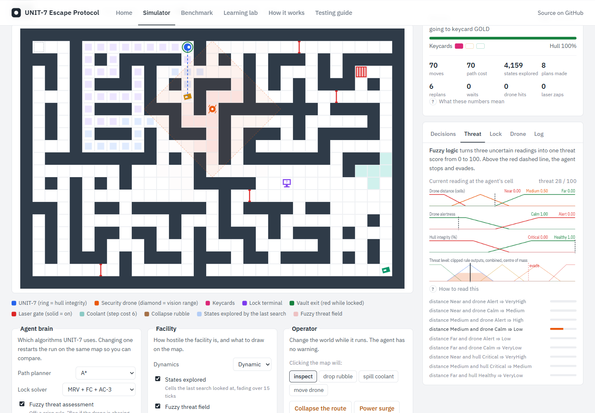

# UNIT-7 Escape Protocol

**CSCI218 Group Project (Topic 10: AI Escape Room).** Made for Dr. Abdullah and Dr. Milan by Group 2, Abdullah Wed 10:30–12:30 lab.

| Member | Student ID |
|---|---|
| Rohan | 8853666 |
| Ibraam | 9001591 |
| Vidhi | 8960008 |
| Zia | 9619951 |
| Yousif | 9851501 |

An AI agent escapes a facility that keeps changing around it. It collects three keycards, solves a lock puzzle at a terminal and reaches the exit. Meanwhile a drone hunts it, laser gates switch on and off, coolant spreads, ceilings collapse onto its route, and power surges rewrite the lock's rules.

| Technique | Job |
|---|---|
| **A\* search** (in space and time) | Plans every route, replans when the route breaks, and times its way through laser gates |
| **Constraint satisfaction** (backtracking, forward checking, MRV, AC-3) | Generates and solves the vault lock, and solves it again when the clues change |
| **Behaviour tree** | Decides what to do each tick: Survive > Escape > Crack the lock > Collect keycards > Hold |
| **Fuzzy logic** (Mamdani) | Rates how dangerous each cell is, from drone distance, drone alertness and hull integrity |
| **Finite state machine** | Controls the drone: Patrol, Alert, Chase, Cooldown |
| **Q-learning** | A learning agent compared against planning in the Learning lab |

**Live site: https://unit7-escape-protocol.vercel.app**. It runs this same Python package in the browser through Pyodide. The first visit takes about 10 seconds while Python starts.



## Requirements

Python 3.9 or later. Only the standard library is used (Tkinter for the window), so there is nothing to install.

## Run it

```bash
python main.py              # desktop demo window
python -m unittest -v       # 19 correctness tests (under a minute)
python evaluate.py          # full evaluation, about 3 minutes -> results/summary.md and CSVs
python evaluate.py --maps 20   # quicker evaluation
python -m http.server       # the website locally, at http://localhost:8000
```

## The website

| Page | What it is for |
|---|---|
| **Home** | What the project is, how each requirement of the brief is covered, and a live run |
| **Simulator** | Watch the agent live. Every technique has its own panel: Decisions, Threat, Lock, Drone and Log. You can change the agent's settings, change the facility while it runs, and follow 8 guided scenarios. |
| **Benchmark** | Run the evaluation in the browser for 7 agent designs, plus planner and lock-solver comparisons, with charts and CSV export |
| **Learning lab** | Train a Q-learning agent, inspect its learned values, then collapse its route and compare it with A* |
| **How it works** | Each technique explained, with links to see it in action |
| **Testing guide** | Run the 19 tests in the browser, and work through a checklist for each requirement |

The desktop app (`python main.py`) has the same controls and panels apart from the Learning lab.

## Results

100 facilities per cell, from `python evaluate.py`. Full tables are in [results/summary.md](results/summary.md).

| Agent design | Static | Dynamic | Chaos |
|---|---|---|---|
| UNIT-7 full: A* + fuzzy + space-time + behaviour tree | 100% | **99%** | **91%** |
| A* + fuzzy, snapshot planning (ignores the gate timetable) | 100% | 92% | 67% |
| A* + crisp avoidance (no fuzzy) | 100% | 99% | 97% |
| Dijkstra + fuzzy + space-time | 100% | 99% | 91% |
| Greedy best-first + fuzzy + space-time | 100% | 94% | 82% |
| BFS + fuzzy + space-time | 100% | 94% | 81% |
| Fixed script (plans once, never adapts) | 100% | **22%** | **7%** |

The design, method and discussion are in [docs/REPORT.md](docs/REPORT.md).

## Files

```
main.py                  desktop demo window (Tkinter)
evaluate.py              full evaluation -> results/
index.html               forwards to website/ (so the site opens at the root URL)
website/                 the six pages: index, simulator, benchmark, learning, how-it-works, testing
  assets/                stylesheet and page scripts; they load escape_room/ into the browser with Pyodide
docs/                    REPORT.md (design, method, results) and the screenshot
escape_room/
  world.py               seeded facility: maze, rooms, keycards, terminal, laser gates, coolant
  search.py              A*, Dijkstra, greedy best-first, BFS; snapshot or space-time
  csp.py                 lock puzzle: generation, four solvers, power-surge changes
  fuzzy.py               Mamdani fuzzy threat controller
  bt.py                  behaviour tree nodes
  agent.py               the agent: decisions, navigation, plan monitoring, lock, evasion, fixed-script baseline
  drone.py               drone finite state machine
  sim.py                 simulation loop, dynamic events, operator tools
  qlearn.py              Q-learning lab
  evaluation.py          experiments
  checks.py              the 19 correctness checks (used by the tests and the Testing page)
  view.py, web.py        panel contents, and the bridge to the website
tests/test_escape_room.py  runs escape_room/checks.py with unittest
results/                 evaluation output (summary.md and one CSV per experiment)
```

## Deployment

The site is static: HTML pages, a little JavaScript for drawing, and the Python package, which Pyodide runs in the browser. `vercel.json` tells Vercel to serve it with no build step. To deploy your own copy, import the repository at vercel.com/new and press Deploy.
