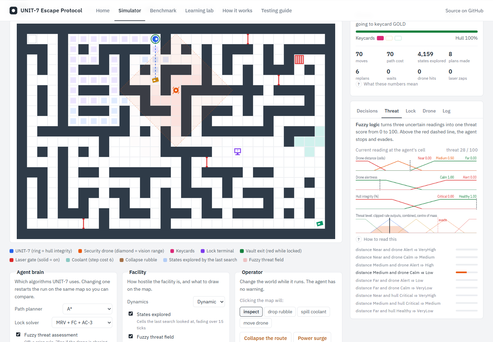

# UNIT-7 Escape Protocol: Design and Implementation Report

**CSCI218 Foundations of Artificial Intelligence, Group Project (Topic 10: AI Escape Room)**
Group 2, Abdullah Wed 10:30–12:30 lab. Submitted to Dr. Abdullah and Dr. Milan.

| Member | Student ID |
|---|---|
| Rohan | 8853666 |
| Ibraam | 9001591 |
| Vidhi | 8960008 |
| Zia | 9619951 |
| Yousif | 9851501 |

## 1. Problem

The brief asks for an escape room in which an intelligent agent navigates an environment, overcomes obstacles, solves challenges and reaches a goal. It must use at least two AI techniques. The environment must change during execution, and the agent must respond to those changes rather than follow a fixed sequence of actions. The solution is evaluated with measures such as completion time, path cost, states explored and success rate.

**Our escape room.** The facility is a 31 × 21 grid generated from a seed: a maze with extra loops and a few open rooms. The agent, UNIT-7, starts in the top-left corner and must:

1. collect **three keycards**, in an order it chooses;
2. reach the **terminal** and solve the **vault lock**, a logic puzzle;
3. reach the **exit**, which opens only while the lock's code is valid.

A mission fails if the hull reaches 0% or 900 ticks pass.

**What changes during a run.** There are three facility levels: Static (nothing changes), Dynamic, and Chaos (more of everything).

| Dynamic element | What happens | Brief's wording |
|---|---|---|
| Security drone | Patrols, investigates and chases the agent. Contact costs 25% hull and a 2-tick stun. | an obstacle moves |
| Ceiling collapses | 3 per run (6 in Chaos), aimed 2–12 steps ahead on the agent's **current planned route** | a route becomes unavailable |
| Power surges | 1 per run (2 in Chaos). Two lock dials are rewired: clues are removed and new ones added, so a known code stops working. | a constraint changes |
| Laser gates | 4 gates, each on for 4 of every 10 ticks on its own timetable. Crossing a live gate costs 12% hull. | a route is periodically unavailable |
| Coolant leak | Spreads one cell every 14 ticks (7 in Chaos). Coolant cells cost 6 to cross instead of 1, and 3% hull. | costs change |

Any of these can also be triggered by hand in the simulator, and the user can drop rubble, spill coolant or move the drone by clicking the map.



## 2. Architecture

```
            ┌──────────────── world + sensors ────────────────┐
            │ tiles, gates, coolant, drone distance field      │
            └───────┬──────────────────────────────┬──────────┘
                    │                              │
          Fuzzy threat (Mamdani)            Drone FSM
       distance · alertness · hull   patrol · alert · chase · cooldown
                    │ threat 0-100                 │ alertness
                    ▼                              │
            Behaviour tree  ◄──────────────────────┘
   Survive › Escape › Crack the lock › Collect keycards › Hold
          │ navigation actions              │ lock action
          ▼                                 ▼
   A* planner (space-time,           CSP lock solver
   threat-weighted, monitored)       (MRV + FC + AC-3)
```

Every tick: scheduled events fire, the coolant may spread, the sensors measure the drone's corridor distance to every cell and the fuzzy system turns it into a threat value, the behaviour tree picks an action, and then the drone moves.

## 3. AI techniques

### 3.1 A* search with plan monitoring (`escape_room/search.py`, `agent.py`)

- **States and moves:** a state is a grid cell, and the agent moves up, down, left or right.
- **Step cost:** 1, or 6 on coolant, plus a threat penalty of up to 30 that grows with the fuzzy threat of the cell (Section 3.4). Routes therefore bend away from danger in proportion to how dangerous it is.
- **Heuristic:** Manhattan distance. Every step costs at least 1, so it never overestimates, and A* returns a cheapest path.
- **Space-time planning.** The laser gates follow a known timetable. In space-time mode a state is (cell, time mod 10) and *waiting* is an action, so A* can plan to pause for a tick and cross a gate as it switches off, instead of taking a long detour. Without it ("snapshot" mode), gates are treated as frozen in their state at planning time.
- **Comparison planners:** the same function runs Dijkstra (no heuristic), greedy best-first (heuristic only) and breadth-first search (ignores costs), so all four can be compared on identical problems. A* and Dijkstra use `heapq`; BFS uses `collections.deque`.

**Plan monitoring.** Every tick the rest of the route is checked. A new plan is made when:

- a cell on the route has become rubble (*route blocked*);
- a gate would be on when the agent arrives (*gate timing*);
- the agent is no longer on its route, for example after evading (*pushed off route*);
- the threat-weighted cost of the remaining route has risen more than 20% above what was planned (*threat drift*).

**Keycard order.** The agent scores all 3! = 6 orders with breadth-first distances and takes the shortest tour that ends at the terminal.

### 3.2 Constraint satisfaction for the lock (`escape_room/csp.py`)

- **Variables:** five dials, D1 to D5.
- **Domain:** each dial is a digit from 0 to 9.
- **Constraints:** all dials differ, sometimes a checksum (D1 + … + D5 = k), and clues such as *D1 is odd*, *D3 > 4*, *D2 + D4 = 11*, *D3 > D5* or *|D1 − D2| = 3*.

**Generating fair puzzles.** The generator picks a secret code, adds random true clues until exactly one code fits, then removes every clue that is not needed. Each puzzle therefore has exactly one answer, and no clue is redundant.

**Four solvers:**

| Solver | What it adds |
|---|---|
| Plain backtracking | Assign dials in order; undo when a clue is broken |
| Forward checking | After each assignment, remove values from other dials that can no longer work (plus node consistency for one-dial clues) |
| MRV + forward checking | Fill the dial with the fewest remaining values first; ties go to the dial in the most clues |
| MRV + FC + AC-3 | Make every pair of dials arc-consistent before searching |

In the simulation, dialling in the code takes one tick per four solver assignments, so a better solver makes the agent escape sooner. When a power surge changes the clues, the old code stops working and the solver runs again on the new constraints.

### 3.3 Behaviour tree for decisions (`escape_room/bt.py`, `agent.py`)

```
? Root (try children in order until one succeeds or is running)
├─ → Survive          ◇ Threat high? (fuzzy)     ▸ Evade drone
├─ → Escape           ◇ Vault unlocked?          ▸ Go to exit
├─ → Crack the lock   ◇ All keycards held?       ▸ Go to terminal   ▸ Solve lock (CSP)
├─ → Collect keycards ▸ Choose keycard order     ▸ Go to keycard (A*)
└─ ▸ Hold position    (when no route exists right now)
```

The tree is evaluated **from the root every tick**, so higher branches interrupt lower ones. When the threat rises, *Survive* takes over at once, and the agent resumes its task when the danger has passed. A power surge needs no special code: *Vault unlocked?* becomes false and the tree falls through to *Crack the lock*.

### 3.4 Fuzzy logic for threat assessment (`escape_room/fuzzy.py`)

"Close", "alert" and "badly damaged" have no sharp boundaries, so the agent rates danger with a Mamdani fuzzy system.

- **Inputs:**
  - corridor distance to the drone (Near / Medium / Far, 0–20 cells; walls give cover);
  - the drone's alertness from its state machine (Calm / Alert);
  - the agent's hull integrity (Critical / Healthy).
- **Rules:** nine, for example *IF distance is Near AND the drone is Alert THEN threat is Very High*, and *IF distance is Medium AND integrity is Critical THEN threat is Medium*. A damaged agent is therefore more careful.
- **Inference:** min for AND, outputs clipped and combined with max, centroid defuzzification, giving a threat from 0 to 100.
- **Uses:** the threat adds to A*'s step costs, and above 68 the behaviour tree switches to evasion. It switches back below 56, a gap that prevents flickering.

The *crisp* baseline replaces all of this with one rule: flee if the drone is chasing within 3 cells, and treat the drone's cell and its neighbours as blocked.

### 3.5 Finite state machine for the drone (`escape_room/drone.py`)

- **Patrol** between waypoints at half speed. It switches to Alert when it sees the agent: within 5 cells (6 in Chaos) with a clear line of sight (Bresenham's line algorithm).
- **Alert:** move toward where the agent was last seen. If the agent is still visible after 2 ticks, switch to Chase; otherwise return to Patrol.
- **Chase** at two-thirds speed until sight is lost for 6 ticks or the 30-tick battery runs out.
- **Cooldown** for 12 ticks (15 after a hit), during which it cannot detect the agent, then Patrol.

The state also sets the drone's *alertness*, which is an input to the fuzzy system.

### 3.6 Q-learning, a learning agent for comparison (`escape_room/qlearn.py`)

The Learning lab trains a tabular Q-learning agent on a smaller 17 × 11 facility with two keycards.

- **State:** (cell, keycards held). **Actions:** four moves.
- **Rewards:** −1 per step, −5 for walking into a wall, +30 per new keycard, +100 for escaping.
- **Training:** ε-greedy, with ε decaying from 1 to 0.05.

It shows why UNIT-7 uses planning for navigation: a learned table only describes the map it was trained on (Section 5.4).

## 4. Implementation

- **Language:** Python 3, standard library only.
- **Three front ends, one package:**
  - `python main.py` opens a Tkinter desktop app.
  - The website runs the same package in the browser with Pyodide (Python compiled to WebAssembly). `escape_room/web.py` returns the simulation state as JSON, and the page scripts only draw it.
  - The tests and the evaluation import the package directly.
- **Reproducibility:** all randomness comes from `random.Random(seed)`, so a seed reproduces the same map, events and results.

| File | Purpose |
|---|---|
| `escape_room/world.py` | Facility generator: maze, loops, rooms, keycards, terminal, laser gates, coolant |
| `escape_room/search.py` | A*, Dijkstra, greedy best-first, BFS, in snapshot or space-time mode |
| `escape_room/csp.py` | Lock generation, four solvers, power-surge mutation |
| `escape_room/fuzzy.py` | Mamdani fuzzy system and the threat rule base |
| `escape_room/bt.py` | Behaviour tree nodes (selector, sequence, condition, action) |
| `escape_room/agent.py` | The agent: decisions, navigation, plan monitoring, lock solving, evasion, fixed-script baseline |
| `escape_room/drone.py` | Drone finite state machine |
| `escape_room/sim.py` | Simulation loop, dynamic events, collisions, operator tools |
| `escape_room/qlearn.py` | Q-learning lab |
| `escape_room/evaluation.py`, `evaluate.py` | Experiments |
| `escape_room/checks.py`, `tests/` | The 19 correctness checks |
| `escape_room/view.py`, `escape_room/web.py` | Panel contents and the bridge to the website |
| `main.py` | Desktop app |
| `website/` | Website: Home, Simulator, Benchmark, Learning lab, How it works, Testing guide |

## 5. Evaluation

**Method.**

- Seven agent designs each ran 100 missions on the same 100 facilities (seeds 5000–5099), at each facility level: 2,100 missions in total.
- Completion time and path cost are averaged over **successful** runs only.
- The two tuned parameters were kept from earlier tuning on a different set of seeds and not re-tuned on these: the threat weight (30) and the evasion threshold (68).
- Full tables and one CSV row per mission are in `results/`.

| Design | Planner | Fuzzy | Space-time | Behaviour tree + replanning |
|---|---|---|---|---|
| **UNIT-7 full** | A* | yes | yes | yes |
| Snapshot | A* | yes | no | yes |
| Crisp | A* | no (crisp rule) | yes | yes |
| Dijkstra / Greedy / BFS | as named | yes | yes | yes |
| **Fixed script** | A*, planned once at tick 0 | no | no | no (the "fixed sequence of actions" the brief warns against) |

### 5.1 Missions

**Success rate**

| Design | Static | Dynamic | Chaos |
|---|---|---|---|
| **UNIT-7 full** | 100% | **99%** | **91%** |
| Snapshot planning | 100% | 92% | 67% |
| Crisp avoidance | 100% | 99% | 97% |
| Dijkstra | 100% | 99% | 91% |
| Greedy best-first | 100% | 94% | 82% |
| BFS | 100% | 94% | 81% |
| **Fixed script** | 100% | **22%** | **7%** |

**Dynamic facility in detail** (ticks and path cost: mean ± std over successful runs)

| Design | Ticks | Path cost | States explored | Replans | Drone hits | Laser zaps | Final hull |
|---|---|---|---|---|---|---|---|
| UNIT-7 full | 209 ± 78 | 214 ± 85 | 17,619 | 9.7 | 0.17 | 0.00 | 89 |
| Snapshot | 220 ± 83 | 222 ± 87 | 6,133 | 18.0 | 0.27 | 0.15 | 84 |
| Crisp | 196 ± 74 | 191 ± 74 | 12,255 | 4.9 | 0.10 | 0.01 | 92 |
| Dijkstra | 212 ± 77 | 219 ± 84 | 27,759 | 9.8 | 0.16 | 0.00 | 89 |
| Greedy | 205 ± 63 | 217 ± 74 | 3,735 | 10.8 | 0.47 | 0.01 | 76 |
| BFS | 192 ± 62 | 201 ± 68 | 19,056 | 9.3 | 0.61 | 0.00 | 74 |
| Fixed script | 124 ± 23 | 128 ± 21 | 303 | 0 | 1.54 | 0.33 | 56 |

Why UNIT-7 replanned (Dynamic, mean per mission): route blocked 1.59, gate timing **0.00**, threat drift or drone 7.12, pushed off route 1.01.

### 5.2 Planners on identical queries

The same 200 start-to-goal queries on 40 maps with 40 extra coolant cells, so the cheapest path is not always the shortest one.

| Planner | States explored | Path cost | Optimal | Cost above optimal |
|---|---|---|---|---|
| A* | **109 ± 81** | 43.6 | **100%** | 0.0% |
| Dijkstra | 201 ± 98 | 43.6 | 100% | 0.0% |
| Greedy best-first | 50 ± 26 | 51.0 | 34% | +16.4% |
| Breadth-first | 205 ± 100 | 46.3 | 55% | +6.2% |
| A* snapshot (gates on) | 111 ± 79 | 44.6 | n/a | n/a |
| A* space-time (gates on) | 724 ± 734 | 43.9 | n/a | n/a |

### 5.3 Lock solvers (100 generated locks, 6.2 clues on average)

| Solver | Assignments | Backtracks | Constraint checks | Correct |
|---|---|---|---|---|
| Plain backtracking | 1,850.8 | 1,845.8 | 3,698 | 100% |
| Forward checking | 53.5 | 48.5 | 1,445 | 100% |
| MRV + forward checking | 13.7 | 8.7 | 715 | 100% |
| **MRV + FC + AC-3** | **7.7** | **2.7** | 817 | 100% |

### 5.4 Learning vs planning (8 lab facilities)

| | Learned policy (Q-learning) | A* |
|---|---|---|
| Training before the first successful escape | 50–250 episodes | none |
| Steps on the trained map | optimal on 7 of 8 maps; 19% longer on the other | optimal |
| After rubble falls on the learned route | **fails on 8 of 8 maps** (walks into the new wall) | replans straight away |
| Recovery | 50–250 more episodes of training | not needed |

### 5.5 Discussion

1. **Adapting is what makes the agent succeed.**
   - With nothing changing, the fixed script does as well as anything (100%). With dynamic events it drops to 22% (Dynamic) and 7% (Chaos).
   - Its failures split between timeouts (46 and 56 runs), when it is stuck behind rubble it cannot route around or at a door relocked by a surge, and destruction by the drone (32 and 37 runs).
   - Its short completion time is misleading: it only finishes on the maps where nothing went wrong.
   - The adaptive agent escaped 99 of 100 Dynamic facilities and 91 of 100 Chaos facilities.
2. **Planning in time removes laser-gate failures.**
   - Snapshot planning replans almost twice as often (18.0 against 9.7) and is zapped 0.15 times per run against none.
   - It succeeds less often: 92% and 67%, against 99% and 91%.
   - Space-time A* never needed a gate-related replan. It costs about 6.5 times more states per query (724 against 111), about 4 ms, which is cheap for what it prevents.
3. **A\* is the right planner.**
   - On identical queries it finds the same optimal paths as Dijkstra while exploring **46% fewer states**, or 37% fewer over a whole mission.
   - Greedy explores the fewest states but is optimal on only 34% of queries. In missions it is hit by the drone almost three times as often, because its routes ignore the threat cost.
   - BFS ignores all costs: it is optimal on 55% of queries and takes 0.61 drone hits per mission.
4. **Constraint propagation matters.**
   - MRV + FC + AC-3 needs about **240 times fewer assignments** than plain backtracking.
   - In the mission that is about 2 ticks at the terminal instead of about 460, which is half the time limit.
   - Each addition helps: forward checking gives the largest single cut, MRV removes about three quarters of what remains, and AC-3 nearly halves it again.
5. **Fuzzy against crisp threat handling: an honest result.**
   - The fuzzy agent did **not** beat the crisp baseline on success: 99% against 99% in Dynamic, and 91% against 97% in Chaos. It was also a little slower (209 against 196 ticks).
   - The crisp baseline is stronger than it looks, because it *forbids* every cell next to the drone while planning, whereas the fuzzy agent *weighs* risk against distance and sometimes accepts a risky shortcut. That is why it takes more drone hits in Chaos (0.40 against 0.16).
   - We also found a failure mode in the logs (seed 19, Dynamic). With a damaged hull, the rule *Near AND Critical → Very High* keeps the threat above the evade line even while the drone is cooling down and harmless. If the drone sits between the agent and the terminal, the agent keeps evading until time runs out.
   - The fuzzy controller's strengths are graded, explainable behaviour (every rule's firing strength is visible live in the simulator) and the threat field it gives the planner, rather than a higher success rate. Section 6 suggests a fix.
6. **Learning needs a stable world.** Q-learning finds near-optimal escapes after a few hundred episodes and then decides with a single table lookup per step, but every collapse on its route breaks it until it is retrained. Planning needs no training and adapts at once. This is why UNIT-7 plans, and why learning appears as a comparison.

## 6. Limitations and possible extensions

- **Full knowledge.** The agent knows the whole map. With partial observability, for example a sensor radius and map discovery, incremental replanning such as D* Lite would become worthwhile.
- **Drone prediction.** Space-time planning knows the gate timetable but not the drone's future moves. A predictive model of the drone could feed time-indexed risk into the same search.
- **Fuzzy rule base.**
  - The cooldown livelock in 5.5 could be fixed with one extra rule input, for example "the drone cannot hurt you in Cooldown".
  - The membership functions were designed by hand. They could be tuned automatically, for example with a genetic algorithm over the benchmark.
- **Tabular Q-learning** cannot generalise across maps; a function approximator could.

## 7. Testing

`python -m unittest -v` runs 19 checks. The same checks (`escape_room/checks.py`) run in the browser on the Testing guide page.

- **Search:**
  - A* returns optimal, valid paths on 200 queries;
  - A* explores no more states than Dijkstra;
  - greedy is not always optimal;
  - space-time paths never stand in a live laser gate;
  - space-time A* matches space-time Dijkstra.
- **Constraint satisfaction:**
  - all four solvers find the code;
  - every lock has exactly one solution;
  - the heuristics never need more assignments than plain backtracking;
  - every power surge produces a valid new puzzle.
- **Fuzzy logic:**
  - the threat never rises as the drone gets farther away;
  - an alert drone is more dangerous than a calm one;
  - a damaged agent is more cautious.
- **Behaviour tree:** Survive interrupts a running action and the action then resumes.
- **Simulation:**
  - runs are reproducible from the seed;
  - the agent escapes every static facility;
  - it recovers from power surges;
  - the adaptive agent clearly beats the fixed script.
- **Reinforcement learning:**
  - Q-learning learns an escape within 25% of the optimum;
  - after a collapse, A* adapts at once while the learned policy must retrain.

All 19 tests pass.

## 8. Reproducing

```bash
python -m unittest -v      # 19 tests, under a minute
python evaluate.py         # all tables in this report, about 3 minutes on a multi-core machine
python main.py             # desktop app
python -m http.server      # the website at http://localhost:8000
```

The live site is https://unit7-escape-protocol.vercel.app. Its Benchmark page reproduces the mission experiments for any seeds, and its Simulator has guided scenarios for each requirement.

## References

Russell, S. and Norvig, P. (2021) *Artificial Intelligence: A Modern Approach*, 4th edn. Pearson. Chapters 3 (search), 6 (constraint satisfaction), 22 (reinforcement learning).

Mamdani, E.H. and Assilian, S. (1975) 'An experiment in linguistic synthesis with a fuzzy logic controller', *International Journal of Man-Machine Studies*, 7(1), pp. 1–13.

Colledanchise, M. and Ögren, P. (2018) *Behavior Trees in Robotics and AI: An Introduction*. CRC Press.
